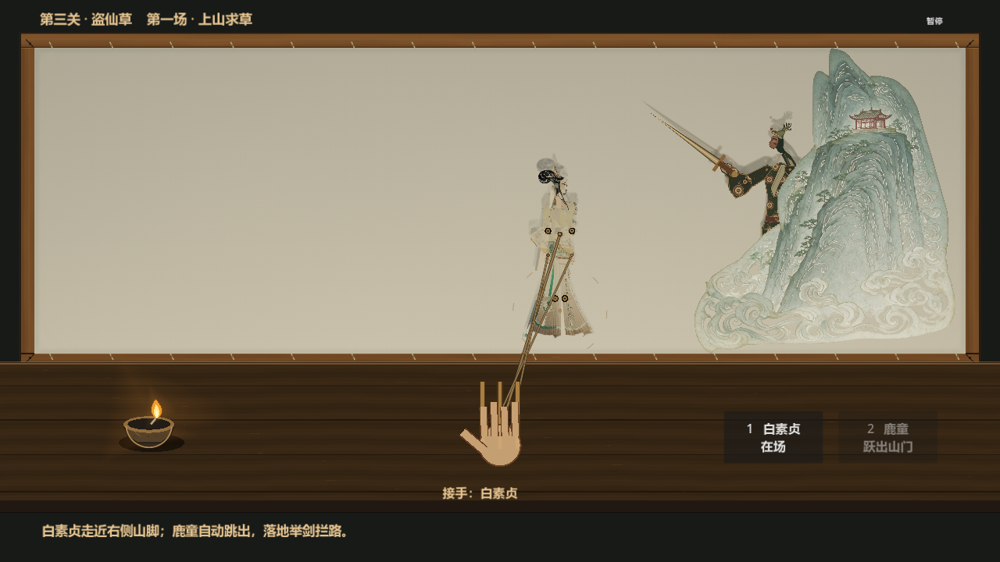
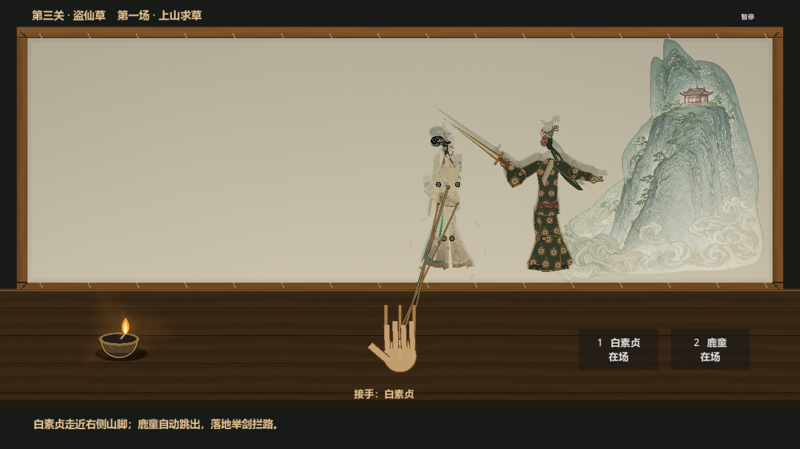
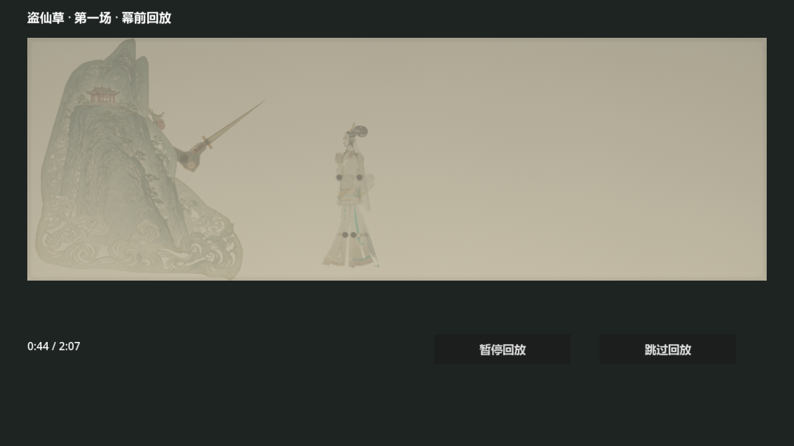

# 第三关第一场：上山求草

> 历史交付记录。2026-10-15 用户明确第三关只有一场，当前已接续双童打戏，旧“第一场暂歇 / 片段结束回放”被替换为同场继续操演。现状与验证见 [连续打戏交付](act3-fight-delivery.md)。

2026-10-14 自由操演修订：第三关开演立即播放用户新视频的完整原声，不等待白素贞出场。白素贞走近右侧山脚时，鹿童自动从山后跳出，落地举剑拦路。鹿童开始跳出后取消后续关键动作，玩家自由发挥，唱腔连续播放到本段原声结束；第一场结束暂歇，提供真实幕前回放。后续素材待用户继续提供。

## 直接排练

在项目目录运行 `& .\tools\play_act3.ps1`，打开已更新的 `builds/dengxia.exe -- --act3-rehearsal`。Godot 编辑器也可打开 `scenes/act3/rehearsal.tscn` 按 F6。正式第二关收场或跳关进入同一戏单。

点击「开演」后立刻响原声。按 1 上白素贞，空格接手，左键拖胸签或手边竹签向右走。靠近山脚便自动触发鹿童；跳出期间不允许接手或收走鹿童，落地后空格可接手。2 只用于鹿童已经跳出后的退场恢复，不提前召出。拖手摆臂；Alt 拖躯干前倾，R 复位上身；右键退场，Q / E 调灯，滚轮推拉灯，ESC 暂停。

前奏不因白素贞尚未出场而停乐。到拦路字头前（约 27.2 秒）若仍未靠山，就等待真实动作；鹿童开始跳出后取消全部关键动作门槛、等待和补救，退场或压暗不再冻结唱腔。菜单暂停冻结原声、跳跃、双时钟、输入与记录。每场出山只触发一次，反复靠山或恢复鹿童不会重跳。

## 音源与时标

新源文件 `aa7e92b07eb85fc79411b51829fcc998.mp4` 已在项目根目录找到，与附件路径中的文件 SHA-256 一致：`ea445cf13f6021335ba5823b4023919f9cfd685321a86713580249146db698df`。视频约 101.84 秒，2400×1080，音轨 AAC / 44100 Hz / 单声道，实际包含 4384 个音频采样块。

`tools/prepare_act3_video.py` 解码得到 4,886,222 帧 48 kHz 双声道 PCM16（101.796 秒），保存为 `assets/audio/act3-mountain/original.wav`。完整保留解码音频，未合成人声、调增益、去噪或转音色；Godot 导入关闭压缩、归一化、裁剪与循环。原声 PCM SHA-256 为 `bf30856b282bebcb5554f7244d3754433e4326a9e79f3bef8b9d548bdd11dc72`，来源证据见 `source.json`。

字幕按新片重新抽帧核对，补上「盗取灵芝，你罪难容」，时轴精度约 0.5 秒；没有声称逐字波形校准。旧 107.2 秒录屏的空音轨结论只适用于旧文件，当前「原声待补」标记已解除。

## 实现与验证

`guard_entrance.gd` 读取现有山景的左缘与白素贞实际站位，触发 0.16 秒蓄势、0.72 秒抛物线腾空（高 100 px）、0.22 秒落地收势。位置、蹲站和手臂关节写入现有 PuppetState；实体、投影、剑复用同一山体外轮廓遮罩。第三关 `performance.guard_behind_mountain` 保存遮挡，幕前只读记录恢复；不重新运行出山逻辑。

统一使用 `D:\Godot\4.7.2\godot.exe`，版本 `4.7.2.stable.official.ed1daf0bf`。以下为自动出山版本的验证基线；本轮自由操演的最新结果见下方补充。日志在 `builds/stage-realism/logs/`。

| 检查 | 结果 |
| --- | --- |
| 修改脚本及测试入口 `--headless --path . --check-only --script ...` | 解析通过 |
| `--headless --path . --script res://tests/c/run_act3_entrance.gd` | 23 项，0 失败；空山前奏、距离触发、腾空、暂停、一次性、接手、记录 |
| `--headless --path . --script res://tests/c/run_act3_story.gd` | 50 项，0 失败；完整第一场与逐采样点回放 |
| `--path . --script res://tests/c/run_act3_story.gd` | 58 项，0 失败；8 张 Windows 图形截图，含幕前跳跃 |
| `--path . --script res://tests/b/run_act3_entrance_graphics.gd` | 18 项，0 失败；WASAPI 真实混音、开场、暂停、恢复、退出与幕前播放 |
| `--headless --path . --script res://tests/c/run_act3_mountain.gd` | 18 项，0 失败；原山景与正式入口 |
| 本次 8 个 GDScript 的 gdformat 与 gdlint | 通过 |
| `--headless --path . --import` | 退出 0 |
| `--headless --path . --quit-after 60` | 退出 0，本次日志无退出告警 |
| `--headless --path . --export-release "Windows Desktop" builds/dengxia.exe` | 退出 0，Windows 包已更新 |
| `builds/dengxia.exe --headless --quit-after 60 -- --act3-rehearsal` | 退出 0，专用入口资源加载通过 |
| `git diff --check` | 通过 |

Windows 检查使用实际图形与 WASAPI 音频设备。空山开场混音峰值约 0.182，暂停为 0；幕前回放开始及恢复都有非零混音，暂停为 0。证据见 `docs/art/act3/entrance-verification.json`；完整剧情加速检查仍在 `verification.json` 明确标记其自身没有执行实时声音检查。

当前没有真人完整试玩或逐字听验结论，第三关后续剧情与整关评分未制作。本次保留第二关、上半身及前次第三关未提交改动，未把这些前置切片混合提交或推送。

## 自由操演修订验收

用户明确要求鹿童跳出后取消关键动作、唱腔不停。本轮删去五个后续动作门槛及相应几何判定，戏单和底部意图改为自由操演。出山前等待保留；鹿童开始跳出即解除动作冻结和入场示范，直至原声结束按素材时长进入暂歇。自由演出的走位、关节、退场和灯态仍真实录入回放。

验证日志前缀 `act3-free-`：定向回归 27 项、完整剧情无头 39 项、Windows 图形剧情回归 47 项、真实 WASAPI 声音检查 23 项，均 0 失败。覆盖跳出后静立唱过旧关键动作点、自由退场、压暗、重新上场、完整播放后自然收场及逐采样点回放。Windows 实测静立 24 秒跨过旧退步抬掌时点，歌曲时间持续前进且有非零混音；退场压暗继续有声，菜单暂停仍静音。证据见更新的 `docs/art/act3/entrance-verification.json`。

本轮导入、启动、Windows 导出与导出包第三关入口均退出 0；默认第一关启动仍有既有的 `2 ObjectDB instances were leaked` / `1 resources still in use at exit` 清理告警，未扩大范围修复。第三关定向回归与专用入口无此告警。6 个修改的 GDScript 格式、lint 和 `git diff --check` 通过。
